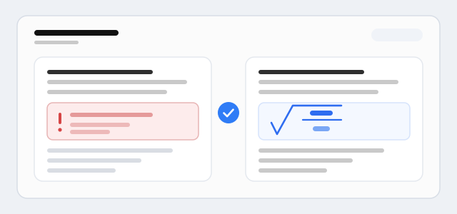

Typical use: install it and reopen the conversation; display-math blocks whose content is glued to the opening and closing double-dollar delimiters render before the message is displayed, and past messages are repaired on the fly without rewriting saved sessions. Nothing needs to be re-sent.

Limits: blocks inside block quotes or list items are left alone; a block with no closing delimiter stays as it is and can still swallow the end of the message; only the delimiter-splitting failure is repaired, so a genuine TeX syntax error still shows the KaTeX error; if the host changes the internal shape it relies on, it silently becomes a no-op instead of breaking the page.
