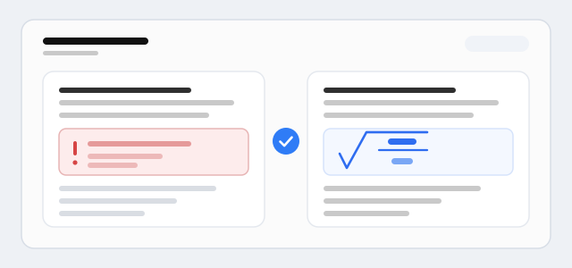

典型用法：装上后重新打开会话；用两个美元符号开栏与收尾、且紧贴内容的公式块，会在渲染前被搬到 DSH 认识的形状；历史消息同样在渲染时修复，不修改已保存的会话，也不需要重发。

限制：块引用或列表项里的公式块不处理；完全没有收尾定界符的块保持原样，仍可能吞到消息末尾；只修定界符取串这一类失败，真正的 TeX 语法错误仍照常报错；宿主改掉它依赖的内部形状时会安静降级为不处理，而不是把页面弄坏。
